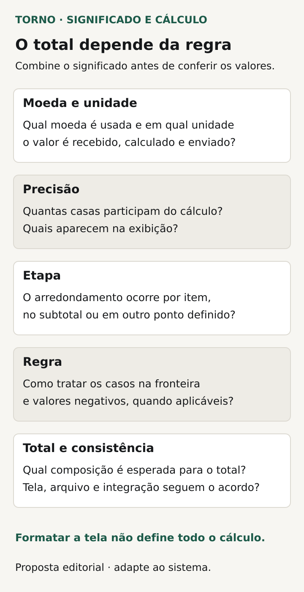

Antes de aceitar valores monetários no sistema, combine **a moeda, a unidade de cada campo, a precisão necessária e em qual etapa o arredondamento será aplicado**. Depois, peça exemplos que permitam conferir o valor calculado, o total apresentado e o conteúdo trocado com outros sistemas, quando houver integração.

“Mostrar duas casas decimais” ainda deixa perguntas abertas. O sistema calcula com quantas casas? O total soma valores já arredondados ou arredonda o resultado da soma? A tela mostra o mesmo valor que será enviado? Essas decisões podem produzir diferenças mesmo com entradas válidas.

Este roteiro é para compradores de portais e ferramentas internas sob medida. Propõe regras e evidências de aceite, sem escolher uma arquitetura universal ou substituir quem responde pelas regras fiscais, contábeis ou contratuais aplicáveis.

## Diga o que cada número representa

Nomeie o significado dos campos: preço unitário, quantidade, desconto, subtotal ou valor final, conforme o processo. Registre moeda e unidade. Um número inteiro recebido por uma integração pode representar uma unidade menor da moeda; não se deve inferir seu significado apenas pela aparência.

A [Stripe documenta como representar valores na API em unidades menores, com regras por moeda](https://docs.stripe.com/currencies). Esse é um exemplo de contrato externo, não uma recomendação de adotar Stripe. Para o comprador, a pergunta é qual unidade cada sistema efetivamente recebe e devolve.

Defina também o significado de zero, campo vazio e valor negativo, se forem possíveis. Ausência de preço e preço igual a zero podem exigir comportamentos diferentes. Peça que o responsável pelo processo valide essas distinções antes de aceitar conversões automáticas.

## Separe cálculo, armazenamento e apresentação

Um preço pode precisar de uma precisão diferente da usada para mostrar o total. Registre quais casas podem entrar, quais participam do cálculo e o que será apresentado. Se um valor ultrapassa a precisão aceita, o sistema deve ter um tratamento definido, em vez de alterar silenciosamente algo que o usuário precisava conferir.

A [documentação do PostgreSQL 18](https://www.postgresql.org/docs/current/datatype-numeric.html) distingue tipos numéricos exatos e aproximados, além de precisão e escala. Isso ilustra uma escolha técnica relevante. Cabe ao fornecedor explicar como a solução preservará o significado dos valores ao longo do fluxo, sem transformar o nome de um tipo em prova suficiente do resultado.

Para a conversa de aceite, use valores conhecidos e peça a memória das etapas necessárias à conferência. O comprador não precisa escolher o tipo da coluna; precisa conseguir relacionar entrada, cálculo e saída ao acordo de negócio.

## Especifique a regra e o momento de arredondar

Defina a precisão de saída e o tratamento dos casos de empate. Dizer “arredondamento normal” não identifica uma convenção. A [referência de Math.Round da .NET](https://learn.microsoft.com/en-us/dotnet/api/system.math.round?view=net-10.0) documenta convenções distintas, incluindo escolhas para valores no ponto médio. É um exemplo de biblioteca, não uma regra imposta ao seu produto.

Combine também a etapa: por item, após um subtotal, no total final ou noutra fronteira justificada pelo processo. Se houver várias etapas, descreva a sequência. Uma regra de arredondamento corretamente aplicada no lugar errado ainda pode contrariar o resultado esperado.

Quando a regra vier de outro sistema ou documento, registre a referência e quem a confirma. Não deixe o fornecedor adivinhar uma exigência fiscal ou comercial. Se a decisão ainda estiver aberta, identifique a pendência antes de fechar o aceite.

## Veja como a etapa muda o total

**Exemplo inteiramente fictício:** duas parcelas têm valor decimal exato de 0,335 cada. Para o exemplo, a regra escolhida é arredondar para duas casas, ao valor mais próximo, levando empates para longe de zero. Os valores não representam preço ou cálculo real de cliente.

Se cada parcela for arredondada antes da soma, cada uma resulta em 0,34. O total dessas parcelas é 0,68. Se a regra mandar somar os valores exatos primeiro, a soma será 0,670; arredondar somente esse total produz 0,67.

As duas sequências estão descritas, mas o produto precisa escolher qual atende ao processo. **Fim do exemplo fictício; não recomenda uma regra universal nem representa implementação ou teste da Torno.**

O exemplo permite escrever um resultado de aceite preciso: qual sequência deve ocorrer e qual total deve aparecer. Uma captura da tela com o total, sem identificar a regra e os valores de origem, deixaria a decisão incompleta.

## Faça uma ficha do cálculo e de suas fronteiras

Use a proposta abaixo para reunir o que o responsável pelo processo e o técnico precisam confirmar. O detalhe de implementação pode ficar em documentação referenciada, desde que a regra seja verificável.

| Decisão | Pergunta para o acordo |
|---|---|
| Moeda e unidade | O que cada número representa na entrada e na saída? |
| Precisão | Quantas casas são aceitas, calculadas e apresentadas? |
| Convenção | Como os casos de empate e os sinais serão tratados? |
| Etapa | Em que ponto ocorre cada arredondamento? |
| Composição | Quais itens, descontos ou ajustes entram no total e em qual ordem? |
| Referência | Qual regra oficial do processo ou do provedor sustenta a escolha? |
| Conferência | Quais entradas e resultados demonstram o acordo? |

*Perguntas propostas para definir o significado e o cálculo antes de conferir os valores. Diagrama original Torno Studio, 2026.*

Inclua como uma diferença será tratada. O sistema impedirá a confirmação, pedirá revisão ou registrará um ajuste previsto? Se houver tolerância, ela precisa ter unidade, finalidade, responsável e alcance explícitos. Não use uma margem genérica para esconder uma divergência ainda sem explicação.

## Confira as passagens entre sistemas e arquivos

Quando houver integração, peça o mapeamento dos campos e a confirmação da regra no destino. Um valor pode estar correto no portal e ser interpretado em outra unidade ou arredondado novamente ao sair. O [briefing de integração com ERP](https://tornostudio.com/blog/integracao-erp-briefing-orcamento/) ajuda a identificar os sistemas e responsáveis dessa conversa.

Combine qual fonte prevalece se os totais divergirem e quem decide a correção. Não é suficiente escolher automaticamente o número que chegou por último. A evidência deve permitir localizar entradas, regra aplicada e resposta conhecida, com acesso apropriado.

Para arquivos, separe representação de significado. O roteiro de [importação de planilhas](https://tornostudio.com/blog/importacao-planilhas-sistema-tratar-erros/) trata modelo e erros de entrada; o de [exportação de dados](https://tornostudio.com/blog/exportacao-dados-sistema-aceite/) trata o uso da saída. Neste aceite, confira se o valor mantém moeda, unidade e sentido após percorrer o caminho contratado.

Não presuma que um aplicativo de planilha reproduzirá o cálculo do sistema só porque apresenta a mesma quantidade de casas. Peça um procedimento de conferência com valores e regras conhecidos, identificando o que foi apenas formatado e o que foi recalculado.

## Demonstre os casos que distinguem as regras

Prepare exemplos fictícios no [ambiente de homologação](https://tornostudio.com/blog/ambiente-homologacao-conferir-antes-testar-sistema/). Escolha casos que ajudem a diferenciar as decisões, incluindo um empate pertinente e uma composição em que arredondar por item produza resultado diferente de arredondar só o total.

Transforme a ficha em [critérios de aceite](https://tornostudio.com/blog/criterios-aceite-mvp/). Antes de executar, combine entrada, sequência e resultado esperado. Esta seleção é uma proposta para adaptar ao produto:

| Cenário | Evidência a conferir |
|---|---|
| Valor com unidade conhecida | Interpretação correta na entrada e na saída |
| Casas além da apresentação | Precisão de cálculo e tratamento conforme a regra |
| Empate de arredondamento | Resultado correspondente à convenção escolhida |
| Total composto por itens | Etapas e soma coerentes com o contrato |
| Zero, ausência ou negativo, quando aplicáveis | Tratamentos distintos conforme o significado |
| Integração ou arquivo previsto | Valor preservado ou convertido como foi acordado |

*Conferências propostas para comparar entradas, regras e saídas com o resultado esperado. Diagrama original Torno Studio, 2026.*

Guarde versão, campos, referência da regra, resultados intermediários necessários e saída observada. Se uma integração foi simulada, registre o limite. Essa demonstração confirma os cenários avaliados; não prova qualquer cálculo futuro nem substitui validação especializada quando necessária.

Para a [conversa inicial com Henrique](https://tornostudio.com/diagnostico/), leve um cálculo representativo, os valores esperados e as regras conhecidas das fontes envolvidas. Isso permite delimitar o comportamento e as evidências da entrega antes de definir a solução técnica.

*Fontes consultadas em 29 de outubro de 2026. A ficha e o exemplo são propostas editoriais originais para adaptação ao produto.*
