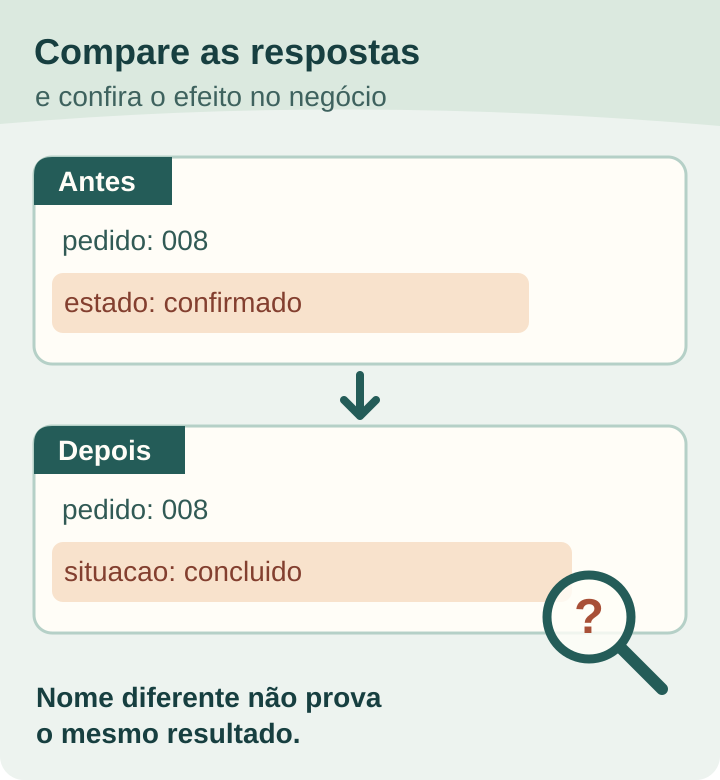

*Leitura estimada: 6 minutos.*

**Para aceitar uma mudança de versão de API, confirme qual versão a integração usa, o que mudou para o fluxo de negócio, por quanto tempo a versão anterior funcionará e quais ensaios demonstram a nova resposta.** Atualizar um endereço ou uma biblioteca não prova que o pedido, cadastro ou relatório continuará correto.

Neste guia, proponho uma ficha que comprador e fornecedor podem preencher juntos. O foco é a decisão de aceite. Se você ainda está mapeando os sistemas e donos da integração, comece pelo [briefing de integração com ERP](https://tornostudio.com/blog/integracao-erp-briefing-orcamento/).

## Registre o contrato que funciona hoje

Peça um inventário curto: provedor, operação usada, versão efetiva, forma de selecionar a versão, campos que entram e saem e comportamento que o sistema espera. Inclua quem recebe avisos de mudança do provedor e onde a documentação é acompanhada. Sem essa referência, "migrar para a versão nova" não define o que precisa continuar funcionando.

O [Azure API Management permite selecionar versões por caminho, cabeçalho ou parâmetro](https://learn.microsoft.com/en-us/azure/api-management/api-management-versions). Isso mostra por que não basta procurar `v1` na URL: o contrato também pode ser escolhido de outra forma. Verifique o mecanismo da API efetivamente usada, sem copiar a solução da Microsoft como padrão obrigatório.

*A ponte representa uma migração a conferir; não é arquitetura nem resultado de cliente. Ilustração original Torno Studio, 2026.*

## Classifique a mudança pelo efeito, não pelo nome da versão

Pergunte quais campos, códigos, regras de validação e significados mudaram. O [AIP-180 do Google distingue compatibilidade de código, de comunicação e de significado](https://google.aip.dev/180). Seu guia alerta que até uma mudança aparentemente aditiva pode afetar um consumidor, dependendo de como ele interpreta a resposta. Essa é uma referência para investigar impactos, não uma garantia aplicável a toda API.

Um exemplo público: a [Stripe documentou a retirada de campos de período do objeto de assinatura e sua presença no item da assinatura](https://docs.stripe.com/changelog/basil/2025-03-31/deprecate-subscription-current-period-start-and-end). Um sistema que lê o campo antigo precisa adaptar a leitura. O exemplo não indica uma integração da Torno com a Stripe; mostra por que o comprador deve pedir a relação entre cada mudança técnica e o resultado operacional.

Separe três perguntas para o fornecedor:

1. O que a integração envia ou lê hoje que deixará de funcionar ou mudará de sentido?
2. Quem confirma o resultado esperado do processo quando a resposta nova chega?
3. Qual operação precisa continuar disponível enquanto a migração é testada?

Uma versão nova pode oferecer funções adicionais sem exigir mudança imediata no seu fluxo. O número da versão, sozinho, não resolve a classificação: leia o changelog e faça o ensaio do contrato que a sua integração usa.

## Combine convivência, comunicação e retorno

Quando houver mudança incompatível, peça ao provedor ou fornecedor a data documentada de suporte da versão antiga, a forma de testar a nova e o plano para migrar. O [AIP-185 descreve convivência de versões e depreciação comunicada nas APIs do Google](https://google.aip.dev/185); o prazo aplicável ao seu caso depende do provedor e do acordo concreto.

Registre o que acontece se o ensaio não passar antes do prazo. É possível manter o fluxo antigo durante a transição? Há dependências que impedem voltar? Quem decide suspender a troca? Para definir sinais e responsáveis, use o [plano de rollback de atualização](https://tornostudio.com/blog/plano-rollback-atualizacao-sistema/) como complemento, sem presumir que toda migração pode ser revertida por um clique.

## Transforme a migração em critérios de aceite

Use dados fictícios num [ambiente de homologação conferido antes do teste](https://tornostudio.com/blog/ambiente-homologacao-conferir-antes-testar-sistema/). Esta ficha é uma proposta editorial, para adaptar à API usada:

| Decisão | Evidência a pedir |
|---|---|
| Versão atual e nova | Requisição e resposta de cada contrato, sem credenciais expostas |
| Campo alterado | Mapeamento do valor antigo e do novo, com significado validado pelo responsável |
| Fluxo principal | Resultado esperado e observado de uma operação completa |
| Falha ou resposta inesperada | Estado apresentado ao usuário e registro de pendência |
| Convivência | Data e condição documentadas para desligar a versão antiga |
| Retorno | Responsável, gatilho e limites de reversão |

*Respostas e lupa são fictícias. A figura ilustra uma pergunta de aceite, não uma tela ou teste realizado. Ilustração original Torno Studio, 2026.*

**Exemplo fictício:** um portal envia um pedido e recebe uma confirmação. No ensaio, crie um pedido de teste na versão atual e outro na nova; confira identificador, estado e o que aparece para a equipe responsável. Se a nova resposta guardar o estado em outro campo, documente o mapeamento e o resultado esperado. Não use um status HTTP de sucesso como única prova de que a operação ficou correta.

Guarde os exemplos usados, a versão da documentação, a saída observada e a decisão sobre pendências. Isso demonstra os cenários avaliados; não garante que o provedor manterá o comportamento para sempre. Vincule cada caso aos [critérios de aceite do MVP](https://tornostudio.com/blog/criterios-aceite-mvp/) ou do sistema contratado.

## Perguntas frequentes

### Toda mudança de API exige uma nova versão?

Não há regra única para todos os provedores. A decisão depende do contrato de compatibilidade publicado e do impacto sobre os consumidores. Peça o changelog da API usada e teste os caminhos da sua integração.

### Se a versão antiga ainda responde, posso deixar a migração para depois?

Confira a política e a data de suporte do provedor. Uma resposta hoje não comprova disponibilidade futura. Registre prazo, responsável e tempo necessário para testar.

### O teste de conexão basta para o aceite?

Não. Ele mostra acesso a uma operação. O aceite também precisa conferir dados, significado, resultado de negócio e comportamento em falhas pertinentes ao escopo.

Se você precisa delimitar uma migração concreta, leve a documentação da API, o fluxo que depende dela e um exemplo sem dados sensíveis para uma [conversa de diagnóstico com Henrique](https://tornostudio.com/diagnostico/).

*Fontes consultadas em 6 de novembro de 2026. As fichas e situações são propostas editoriais fictícias; cada contrato externo deve ser conferido na documentação vigente antes da implementação.*
