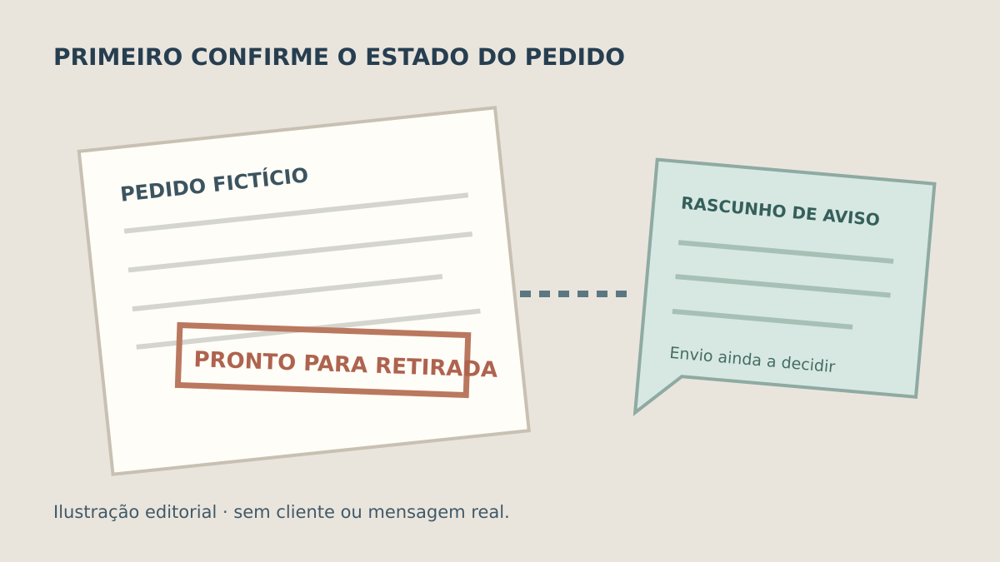
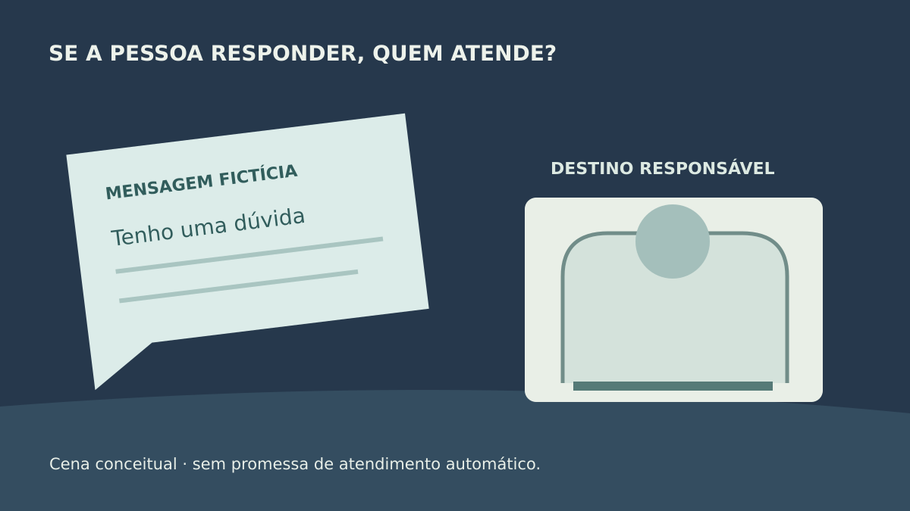

**Antes de integrar avisos automáticos por WhatsApp ao sistema, defina qual mudança real justifica cada mensagem, quem autorizou o contato e o que acontecerá quando a pessoa responder ou o envio falhar.** O botão “enviar” não resolve essas decisões. Um aviso útil depende do estado correto do pedido, de uma regra de contato e de uma forma de conferir o resultado.

Este roteiro trata de atualizações de pedidos, agendamentos e solicitações em um sistema próprio. Não é uma campanha de marketing, uma cotação da plataforma nem uma garantia de entrega ou leitura. As regras da WhatsApp Business Platform devem ser verificadas novamente no momento da implantação.

## Qual evento autoriza o aviso?

Escolha um processo concreto: “pedido confirmado” é mais verificável do que “avisar o cliente”. Combine quem confirma, qual registro identifica o pedido e se a mensagem sai antes ou depois da gravação do novo estado. Se o pedido ainda pode ser recusado ou corrigido, determine quando o texto seria prematuro.

**Exemplo inteiramente fictício:** um portal altera um pedido para “pronto para retirada”. O aviso contém referência do pedido e instrução de retirada, sem detalhes sensíveis. Se uma pessoa clica em “pronto” duas vezes, o cliente não deve receber dois avisos equivalentes por esse único estado. Se o estado for revertido, o responsável decide se haverá correção e qual será seu texto. **Fim do exemplo fictício; não representa projeto ou cliente da Torno.** O guia sobre [eventos duplicados na integração](https://tornostudio.com/blog/integracao-evento-duplicado-regra-negocio/) ajuda a especificar o segundo envio.

*O carimbo e o texto são fictícios e não representam interface, cliente ou mensagem enviada. Ilustração original Torno Studio, 2026.*

## Quem pode receber e qual texto pode sair?

A [política oficial do WhatsApp Business](https://whatsappbusiness.com/policy/) exige que a pessoa tenha fornecido seu contato e dado permissão para receber mensagens, além de respeitar pedidos para interrompê-las. Defina onde essa permissão será registrada, qual finalidade cobre, como o cliente poderá deixar de receber avisos e quem manterá o registro. Ter um telefone no cadastro, por si só, não documenta essa autorização.

Na Business Platform, a [mesma política](https://whatsappbusiness.com/policy/) exige um modelo aprovado para a empresa iniciar uma conversa; fora da janela de atendimento de 24 horas após mensagem do usuário, também limita o envio a modelos aprovados. Os modelos têm finalidade própria e podem ser revistos pela plataforma. Não escreva uma campanha promocional disfarçada de atualização operacional. O responsável pelo projeto deve conferir as regras atuais e o tipo de aviso planejado antes de aprovar o fluxo.

Prepare o texto com o mínimo de dados necessário para reconhecer a atualização. Decida idioma, horário, remetente, canal de resposta e quem aprova mudanças no modelo. A página de [preços da plataforma](https://whatsappbusiness.com/products/platform-pricing/) separa categorias de mensagem e permite consultar tarifas por mercado e moeda. Assim, uma estimativa de custo precisa partir de volume e categorias reais; este artigo não atribui preço fixo à integração.

## O que acontece quando o cliente responde?

Uma mensagem de serviço pode gerar uma dúvida, uma correção de endereço ou um pedido de ajuda. Especifique se a resposta ficará visível no sistema, quem a receberá e quando deverá ser encaminhada a uma pessoa. A [política permite automação durante a janela de atendimento, mas pede caminhos claros e diretos de escalonamento](https://whatsappbusiness.com/policy/). O [blog técnico oficial descreve webhooks para receber mensagens e encaminhar casos não resolvidos automaticamente](https://whatsappbusiness.com/blog/how-to-use-webhooks-from-whatsapp-business-api/). Isso mostra possibilidades da plataforma, não uma função pronta do software que está sendo contratado.

Decida também o que fazer se a pessoa não responder. “Não respondeu” não equivale a “não recebeu” nem a “aceitou”. Se a confirmação for indispensável para avançar o pedido, trate essa confirmação como uma ação separada. Um aviso por WhatsApp pode apoiar o processo, mas não deve virar comprovante automático de que o cliente concordou com outra decisão.

*A figura destaca o destino da resposta; balões e pessoas são conceituais. Ilustração original Torno Studio, 2026.*

## Como demonstrar envio e falha no aceite?

Peça ensaios com números de teste autorizados e mensagens fictícias. Confira o registro do pedido, a regra de contato, a tentativa de envio e o estado informado pelo serviço usado. O guia sobre [e-mails do sistema](https://tornostudio.com/blog/emails-sistema-envio-entrega-falha/) mostra por que pedido de envio, entrega e ação do destinatário devem ser separados. A mesma distinção evita uma tela de WhatsApp que diga “cliente avisado” apenas porque o sistema tentou enviar.

| Ensaio | Resultado a conferir |
|---|---|
| Estado do pedido ainda não confirmado | Nenhuma mensagem anunciando conclusão |
| Destinatário sem permissão de contato | Aviso não enviado; motivo tratável por responsável |
| Gatilho repetido | Sem duplicar indevidamente o aviso do mesmo estado |
| Tentativa com falha | Pendência identificável; não mostra sucesso fictício |
| Cliente responde com dúvida | Mensagem chega ao destino responsável acordado |
| Cliente pede para não receber mais | Próximos avisos respeitam a decisão registrada |

Defina quais eventos merecem [evidência na trilha do sistema](https://tornostudio.com/blog/trilha-auditoria-sistema-requisitos-negocio/) e como corrigir um erro sem repetir mensagens ou expor dados pessoais. Isso não exige publicar conversas reais em um relatório de aceite.

Para [conversar com Henrique sobre escopo](https://tornostudio.com/diagnostico/), leve um fluxo, exemplos de mensagens sem dados reais, volume estimado, origem da permissão de contato e responsável por responder. Esses itens ajudam a comparar integração direta, uso de plataforma intermediária e outras opções antes de contratar.

*Política e páginas oficiais consultadas em 3 de novembro de 2026; verifique atualizações antes de implementar. Cenário e figuras são editoriais, sem alegação de envio ou resultado real.*
